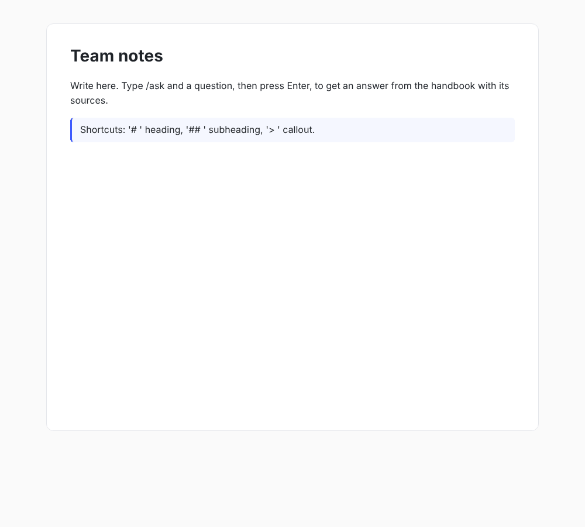

# kb-agent

A knowledge base you can ask questions while you write. Connectors keep an index of your team's documents and tickets up to date. A LangGraph agent answers questions only from that index and cites its sources, and a Slate editor turns `/ask …` into an answer block with citation chips.



## Pieces

```
connectors (Markdown folder, ticket tracker API) ──▶ indexer ──▶ Postgres full-text chunks
                                                       │ Redis lock per source
React + Slate editor ──/ask──▶ Fastify API ──▶ LangGraph agent: plan → retrieve → respond → verify
```

**Connectors** (`server/src/connectors`) implement one small interface: give me the changes since this cursor, a page at a time.

- **Markdown folder.** Finds changes and deletions by comparing modification times.
- **Ticket tracker REST API.** Incremental by `updated_since` with opaque page tokens. It retries 429s after `Retry-After`, and turns archived tickets into deletions.

Adding a source means writing one class.

**Indexer.**

- **Chunking.** Documents are split at headings into sections that keep their heading path, for example `VPN setup › macOS`, so answers can point at a section instead of a whole page.
- **Change detection.** Content hashes skip unchanged documents.
- **Crash safety.** Each page of changes and its cursor are committed in one transaction, so a crash re-reads a page rather than losing one.
- **One sync at a time.** A Redis lock, released only by its owner, stops two workers from syncing the same source.

**Search** uses Postgres full-text search. Headings weigh more than bodies, and every typed term becomes an optional prefix, so "vpn mac" finds "VPN setup › macOS".

**The agent** is a LangGraph state machine:

1. **plan** rewrites the question into search queries.
2. **retrieve** merges and ranks hits.
3. **respond** answers only from numbered sources.
4. **verify** checks every `[n]` the model cites.

An answer that cites sources it wasn't given, or cites nothing, is sent back once with specific feedback. If it still fails, it is returned marked `grounded: false`, and citations to nothing are stripped. When nothing relevant is found, the agent says so without asking the model to answer.

**The editor** (`web/`) is React and Slate:

- `# `, `## ` and `> ` shortcuts.
- Enter after a heading continues with a paragraph.
- `/ask` becomes an answer block that shows progress, failures with retry, a warning for ungrounded answers, and citation chips that link to the sources.

An answer that arrives after its block was deleted is dropped. Components have Storybook stories with mock data.

## Running it

```bash
docker compose up -d
cd server && npm ci
DATABASE_URL=postgres://kb:kb@localhost/kb_agent REDIS_URL=redis://localhost:6379 npm start   # API on :3000
curl -X POST localhost:3000/sources/handbook/sync                                           # index examples/handbook
cd ../web && npm ci && npm run dev                                                            # editor on :5173
cd web && npm run storybook                                                                   # components with mock data
```

Set `OPENAI_API_KEY` (and optionally `KB_MODEL`) to use a real model. Without one, the API uses `OfflineModel`, a deterministic stand-in so everything runs offline. It plans by keeping keywords and answers by quoting the best-matching sentence. It is not a language model, but the agent graph, verification and UI behave the same way. Set `TICKETS_URL` and `TICKETS_TOKEN` to add the ticket connector.

## Tech stack

Node.js 22, TypeScript (strict), LangGraph.js, Fastify, PostgreSQL full-text search, Redis (ioredis), zod, React 19, Slate, Vite, Storybook, vitest, Testing Library

## Tests

```bash
cd server && npm run typecheck
KB_TEST_DATABASE_URL=postgres://kb:kb@localhost/kb_agent KB_TEST_REDIS_URL=redis://localhost:6379/1 npm test
cd ../web && npm run typecheck && npm test && npm run build-storybook
```

Server tests run on real Postgres and Redis and cover:

- connectors against a fake tracker API, including a 429;
- resuming after a failed page, and the sync lock;
- search ranking;
- each agent path with a scripted model;
- the HTTP API end to end.

Web tests cover editor commands on a headless Slate editor and the answer block's states.

## License

MIT
